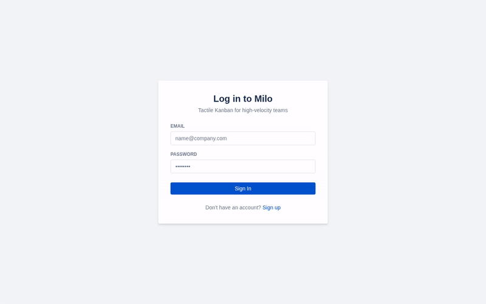
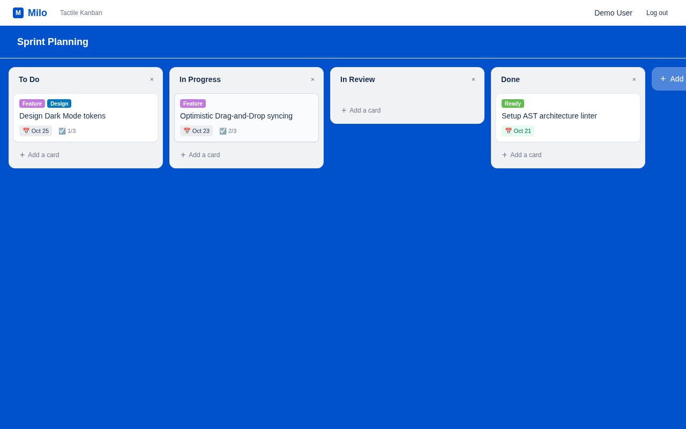
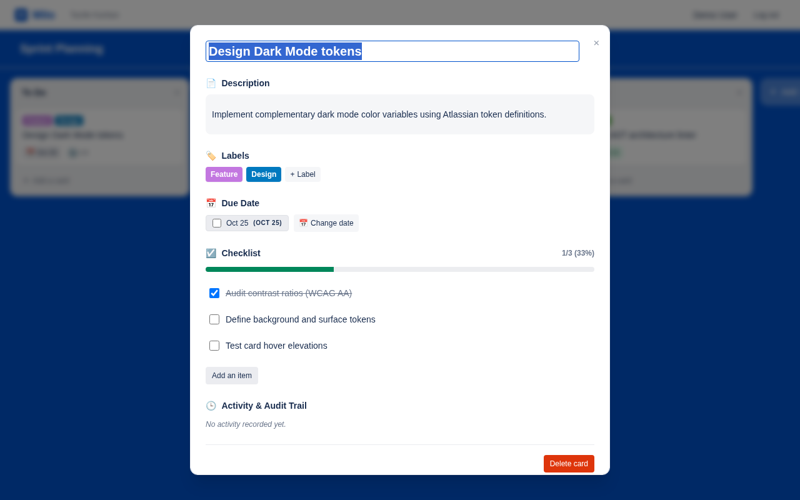
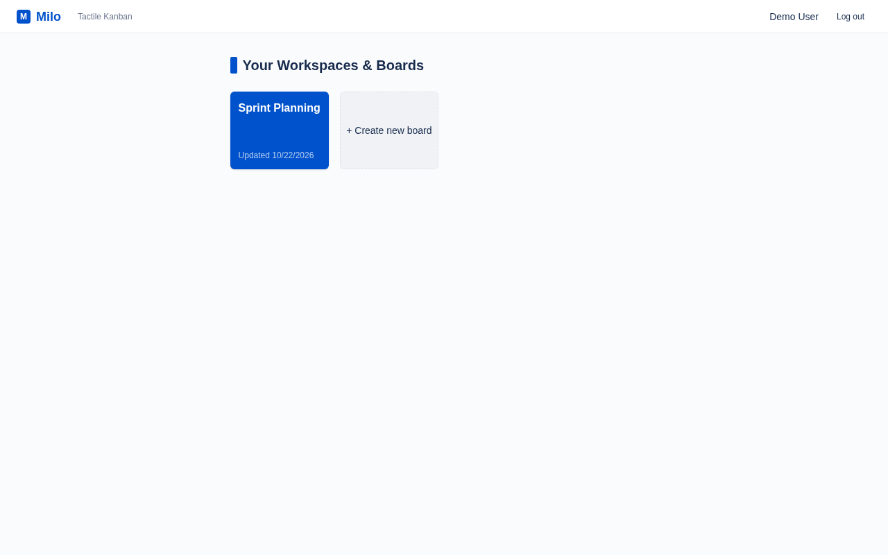
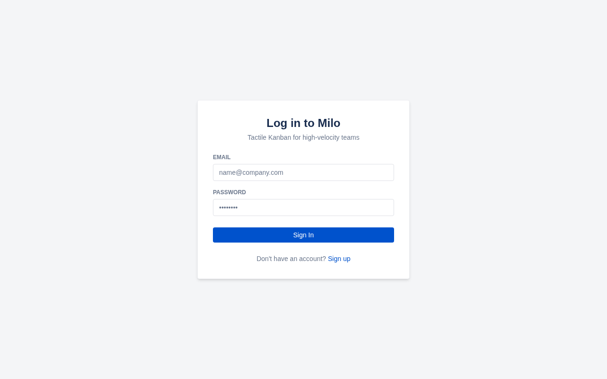

<div align="center">

# 📋 Milo Boards

**An agent-verifiable, tactile Trello clone built with Next.js App Router, Atlassian Design System tokens, `@hello-pangea/dnd`, and zero-mock SQLite.**

[](https://nextjs.org/)
[](https://www.typescriptlang.org/)
[](https://tailwindcss.com/)
[](https://biomejs.dev/)
[](https://vitest.dev/)
[](https://www.prisma.io/)
[](LICENSE)

<br />

<p align="center">
  
</p>

</div>

---

## 🌟 Overview

**Milo** is a fast, tactile web Kanban board replicating Trello's core user experience with high-fidelity Atlassian Design System tokens. Built from the ground up for strict architectural integrity and autonomous AI-agent navigability, Milo pairs fluid 60fps drag-and-drop interactions with mechanical boundary enforcement, zero barrel files, typed error handling, and zero-mock SQLite integration testing.

---

## ✨ Features

### 1. Fluid Kanban Board Canvas
- Horizontal-scrolling canvas with custom Atlassian theme colors.
- Smooth drag-and-drop within columns and cross-column reordering powered by `@hello-pangea/dnd`.
- Spaced integer ranking (intervals of 1000) using pure calculation math (`src/shared/calc/reorder.calc.ts`).
- Instant optimistic UI feedback with background synchronization via Next.js Server Actions.

<p align="center">
  
</p>

### 2. Rich Card Details Modal
- **Inline Editing**: Live title and markdown-styled description editor.
- **Color Labels**: Atlassian palette tags (`Feature`, `High Priority`, `Design`, `Ready`).
- **Interactive Checklists**: Real-time progress bar with fraction and percentage counters (`2/3 (67%)`).
- **Due Date Tracker**: Visual badges with status intelligence (`Overdue`, `Due soon`, `Complete`).
- **Immutable Audit Trail**: Chronological activity feed logging all actions (`CREATED_CARD`, `MOVED_CARD`, `TOGGLED_CHECKLIST_ITEM`) with actor timestamps.

<p align="center">
  
</p>

### 3. Workspaces & Boards Dashboard
- Personal and team workspaces with quick board creation.
- Responsive board card grid with custom color backgrounds and last-updated metadata.

<p align="center">
  
</p>

### 4. Lightweight Cookie-Based Authentication
- Secure authentication using Web Crypto / scrypt password hashing.
- Cryptographically signed HMAC-SHA256 session tokens in HTTP-only, SameSite cookies.
- Protected route layout with instant redirection.

<p align="center">
  
</p>

---

## 🏛️ Architecture & Mechanical Invariants

Milo is architected with strict Vertical Feature Slices and layered boundaries:

```
[ Next.js App Router (src/app/) ]
               │
               ▼
[ Features (src/features/<domain>/) ]
  ├── components/    --> React presentation & optimistic interaction
  ├── <d>.api.ts     --> Server Actions (Input validation boundary via Zod)
  ├── <d>.service.ts --> Pure domain rules, CQRS & transaction coordination
  ├── <d>.repo.ts    --> Isolated Prisma database queries
  └── <d>.presenter.ts-> Pure view-model calculations (progress %, due dates)
               │
        ┌──────┴──────────────────────────┐
        ▼                                 ▼
[ Shared Infrastructure ]       [ Database (SQLite / Prisma) ]
  ├── shared/kernel/              ├── src/server/db/client.ts
  ├── shared/calc/                └── prisma/schema.prisma
  ├── shared/ui/
  └── shared/telemetry/
```

### Inviolable Core Rules
1. **No UI in Server/DB**: `.tsx` files, hooks, and styling tokens must **never** exist inside `src/server/` or `src/server/db/`.
2. **No Generic `lib/` or `utils.ts`**: The filename `utils.ts` is strictly **banned**. Logic is cleanly isolated in `shared/kernel/`, `shared/calc/`, `shared/ui/` (`cn.util.ts`), or `shared/telemetry/` (`logger.ts`).
3. **No Root Barrel Files**: Banned root `index.ts` re-exports to eliminate circular dependencies and optimize builds ([ADR 001](docs/ADR/001-no-barrel-files.md)).
4. **Repo & Service Split**: Business logic lives in `<domain>.service.ts`; database operations live in `<domain>.repo.ts` ([ADR 004](docs/ADR/004-repo-service-split.md)).
5. **Strict `Result<T, E>` Return Discipline**: Expected failures return typed `Result.success(data)` or `Result.failure(code, message)` rather than throwing untyped runtime exceptions.
6. **File Size Limit (< 400 LOC)**: Every file in `src/` must remain under 400 lines of code, mechanically enforced by `bun run check:size`.

---

## 🚀 Quick Start

### Prerequisites
- [Bun](https://bun.sh/) (v1.1+)
- Node.js (v18+)

### Installation & Seeding

```bash
# 1. Clone the repository
git clone https://github.com/paramcodes/milo.git
cd milo

# 2. Install dependencies
bun install

# 3. Synchronize database schema and seed the demo board
DATABASE_URL="file:./dev.db" bunx prisma db push
DATABASE_URL="file:./dev.db" bun run seed

# 4. Start the development server
DATABASE_URL="file:./dev.db" bun run dev
```

Open [http://localhost:3000](http://localhost:3000) in your browser.

**Demo Credentials**:
- **Email**: `demo@milo.app`
- **Password**: `password123`

---

## 🧪 Testing & Verification Pipeline

Milo features 100% zero-mock integration testing running on ephemeral SQLite databases (`file:test.db`), asserting real foreign key cascades and transactions ([ADR 003](docs/ADR/003-ephemeral-sqlite-testing.md)).

Run the canonical verification suite before committing:

```bash
bun run check:arch      # AST architectural linter (enforces layer boundaries)
bun run check:size      # Fails if any file > 400 lines (prevents god-files)
bun run check           # Biome format & lint checker
bun run typecheck       # Fast strict TypeScript typecheck (tsc --noEmit)
bun run knip            # AST scanner for dead code, unused exports & dependencies
bun run test            # Colocated unit & zero-mock SQLite integration tests
bun run build           # Production Next.js App Router build
```

---

## 🤖 Browser Driving & Verification with `agent-browser`

Milo supports headless browser automation via [`agent-browser`](https://www.skills.sh/vercel-labs/agent-browser/agent-browser), allowing agents and CI to drive user flows, verify accessibility, and capture regression artifacts:

```bash
# Start production server
DATABASE_URL="file:./dev.db" bun run start -p 3000

# Run agent-browser to log in and inspect the board
agent-browser set viewport 1280 800
agent-browser open http://localhost:3000/login
agent-browser fill @e2 "demo@milo.app"
agent-browser fill @e3 "password123"
agent-browser click @e4
agent-browser wait 2000
agent-browser screenshot docs/assets/dashboard.png
agent-browser close
```

---

## 🤝 Contributing

Contributions are warmly welcomed! Please read our [Contributing Guide](CONTRIBUTING.md) and [Code of Conduct](CODE_OF_CONDUCT.md) before opening pull requests.

---

## 📄 License

Milo is open-source software licensed under the [MIT License](LICENSE).
